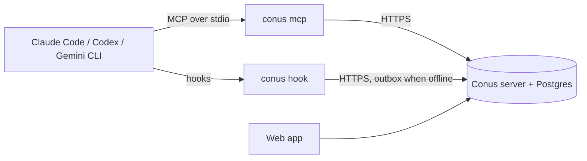

<h1 align="center">
  <picture>
    <source media="(prefers-color-scheme: dark)" srcset="docs/assets/conus-animated-dark.svg">
    
  </picture>
</h1>
<p align="center"><b>A task manager your AI agents keep themselves.</b></p>
<p align="center">English · <a href="README.ru.md">Русский</a></p>

You work with Claude Code or Codex as usual and never mention a task manager. The agent creates the main tasks,
takes them into work, marks what blocks it, completes them with a result and drops what you abandoned. After a
session Conus shows what is in progress and what got done: who changed what, when and in which session, with the
commits.

Conus tracks main tasks only: features, notable fixes, important bugs, decisions that lead to separate work. Small
edits and the steps of an agent's plan never become tasks; they end up in the result of the main task.

## How it works

"The agent keeps the tasks itself" takes three levels, each with its own mechanism:

| Level | Meaning | Mechanism |
|---|---|---|
| 1. Access | the agent can call the operations | an MCP server and a REST API |
| 2. Understanding | the agent knows when to call them | a protocol delivered by hooks, a skill and instructions |
| 3. Reliability | the board does not depend on the model's memory | hooks on tool use and on stop, server-side reconciliation, a local outbox |



On every agent machine `conus-cli` runs the agent's hooks and the `conus mcp` bridge. Hooks report facts (edited
files, commits, test runs) and hand the agent a short snapshot of its open tasks at the start of a session and on
every prompt. At the end of a turn the server checks the facts against the board and, when a main task was
clearly left behind, asks the agent to update it. When the server is down, nothing stops: events wait in a local
outbox and the agent keeps working.

## Quick start

### 1. Run the server

You need Docker with Compose v2.

```bash
curl -fsSL https://raw.githubusercontent.com/Pandusss/conus/main/deploy/install.sh | sh
```

The installer puts `compose.yml` and a generated `.env` (a random database password, a setup code) into `./conus`,
starts the server and prints its address and the setup code. It asks one question: a domain for HTTPS.

- **No domain**: Conus runs on http://localhost:8080 of this machine. Good for trying it and for agents on the same
  machine.
- **A domain** whose A record points at the server, with ports 80 and 443 free: Caddy gets a Let's Encrypt
  certificate and Conus is on `https://<domain>`.
- **Your own reverse proxy**: answer with no domain, then point the proxy at `127.0.0.1:8080` and set
  `CONUS_PUBLIC_URL` in `.env` to the public address.

Open the address, enter the setup code and choose the owner password.

### 2. Connect your agents

In the web app open **Agents → Connect agent**, name the agent and copy the two commands. On the agent's machine
(Node.js 22 or newer):

```bash
npm install -g --allow-remote=all https://github.com/Pandusss/conus/releases/latest/download/conus-cli.tgz
conus setup https://conus.example.com conus_xxxxxxxx
```

The package comes from the latest GitHub release; `--allow-remote=all` lets npm 12 and newer install from a URL
(older npm ignores it).

`conus setup` logs in, then connects every agent it finds: the Conus plugin in **Claude Code** (through the
`claude` CLI; without it, it prints the two `/plugin` commands to run in Claude Code), the MCP server, hooks and
skill in **Codex**, the MCP server in **Gemini CLI**. It offers to add a short Conus rule to each agent's global
instructions and finishes with `conus doctor`. Restart the agents afterwards. In Codex, approve the hooks once
with `/hooks`.

To install only the Claude Code plugin by hand (after `conus login <url> <token>`), run in Claude Code:

```
/plugin install conus --marketplace Pandusss/conus
```

Any other MCP client: add a stdio server that runs `conus mcp`, and add the protocol block to the repository with
`conus init --agents-md`.

That is all: from now on the agents keep the board themselves.

## Privacy

Only this leaves an agent's machine:

- paths of changed files, relative to the repository root;
- sha and subject of commits;
- the git remote address (without login or password), the branch, the `HEAD` sha, the repository folder name and
  a hash of its path;
- the working directory relative to the repository root;
- the agent's model name;
- command lines of test runs (up to 300 characters, simple commands only — never from scripts with a heredoc, and
  for PowerShell never with a here-string, backtick line continuation or `-EncodedCommand`);
- excerpts of the prompt and the answer, up to 2000 characters;
- titles and texts of tasks written by the agent;
- service data: the agent's session id, the names of the Conus tools called, task refs.

File contents and diffs are never sent. Prompt and answer excerpts can be turned off; the server then works from
facts only (commits and files):

```bash
conus config set send_text false
```

The token lives in `~/.conus/config.json`, readable by its owner only; the server stores only its SHA-256 hash, and
you can revoke it in the web app. The optional judge (see below) sends the turn's facts and excerpts to the
Anthropic API.

To stop tracking in one repository, run `conus disable` in it (`conus enable` turns it back on). Folders outside git
are never tracked.

## Configuration

### Server (`.env` next to `compose.yml`)

| Variable | Default | Meaning |
|---|---|---|
| `POSTGRES_PASSWORD` | generated | Database password: letters and digits only. Used once, when the database volume is created. |
| `CONUS_PUBLIC_URL` | `http://localhost:8080` | The address people and agents use. |
| `COMPOSE_PROFILES=https`, `CONUS_DOMAIN` | off | The built-in HTTPS with Caddy and Let's Encrypt. |
| `CONUS_PORT`, `CONUS_BIND` | `8080`, `127.0.0.1` | Where the app listens on the host. |
| `CONUS_VERSION` | `latest` | The image tag, e.g. `0.1.0`. |
| `CONUS_LANG` | `en` | `en` or `ru`: the language of what the server writes — chat notes, the agents' status line, task history. The web app has its own language switch. |
| `CONUS_SETUP_CODE` | generated | The code for the first visit. Empty: a random one is printed in `docker compose logs app`. |
| `ANTHROPIC_API_KEY` | empty | Turns on the judge: an LLM check at the end of a turn and short summaries of tasks the janitor sends to review. Without it the deterministic checks still run. |
| `CONUS_JUDGE_ENABLED`, `CONUS_JUDGE_MODEL` | `true`, `claude-haiku-5-5` | The judge switch and model. |

Update: run the installer again, or `docker compose pull && docker compose up -d` in the `conus` folder.
Back up: `docker compose exec db pg_dump -U conus conus > conus.sql`.
Forgot the owner password: `docker compose exec app node dist/admin.mjs reset-password`.

### Agent machines

`conus setup` writes `~/.conus/config.json`. `CONUS_URL` and `CONUS_TOKEN` override it (handy in CI),
`CONUS_CONFIG_DIR` moves it. Messages are in English, or in Russian when the locale is Russian (`CONUS_LANG`
forces one).

## Troubleshooting

- Run `conus doctor`: it checks the configuration, the server, the token, that `conus` is on PATH, each agent and a
  test session in the current repository. `✓` is fine, `!` is a warning, `✗` is an error (exit code 1).
- Hooks never interrupt the agent and stay silent on errors; they log to `~/.conus/logs/hook.log`.
- `✗ token`: the token was revoked or mistyped. Issue a new one in the web app and run `conus setup` again.
- `! path`: agents start `conus` from hooks; add npm's global bin directory (`npm prefix -g`) to PATH, for desktop
  apps too.
- `! codex` with a hint about `/hooks`: open Codex and approve the hooks.
- The server is down: work goes on; events collect in `~/.conus/outbox` and are sent on the next successful call.

## The name

*Conus textile*, the cloth-of-gold cone snail, draws the pattern on its shell one growth line at a time, each spot
following a simple rule about its neighbours — a cellular automaton in a living thing. The logo is that kind of
automaton, Rule 30, grown from a single cell: it grows into a cone. Conus works the same way: every agent follows a
small protocol, and an orderly board grows out of it.

## Contributing

Issues and pull requests are welcome; see [CONTRIBUTING.md](CONTRIBUTING.md). Report vulnerabilities privately:
[SECURITY.md](SECURITY.md).

## License

[MIT](LICENSE)
