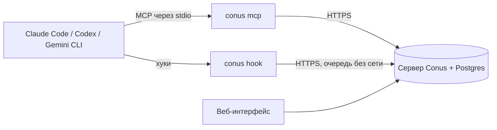

<p align="center">
  
</p>
<h1 align="center">Conus</h1>
<p align="center"><b>Менеджер задач, который ведут сами ИИ-агенты.</b></p>
<p align="center"><a href="README.md">English</a> · Русский</p>

Вы работаете с Claude Code или Codex как обычно и не упоминаете менеджер задач. Агент сам заводит основные задачи,
берёт их в работу, отмечает блокировки, закрывает с итогом и отменяет то, от чего вы отказались. После сессии
Conus показывает, что в работе и что сделано: кто, когда и в какой сессии что изменил, вместе с коммитами.

Conus записывает только основные задачи: фичи, заметные исправления, важные баги, решения, за которыми последует
отдельная работа. Мелкие правки и шаги плана агента задачами не становятся — они попадают в итог основной задачи.

## Как это работает

Требование «агент ведёт задачи сам» раскладывается на три уровня, и у каждого свой механизм:

| Уровень | Что значит | Механизм |
|---|---|---|
| 1. Доступ | агент технически может вызывать операции | MCP-сервер и REST API |
| 2. Понимание | агент сам понимает, когда их вызывать | протокол, который доставляют хуки, скилл и инструкции |
| 3. Надёжность | доска не зависит от «памяти» модели | хуки на инструменты и на остановку, серверная сверка, локальная очередь |



На каждой машине с агентом `conus-cli` выполняет хуки агента и мост `conus mcp`. Хуки сообщают факты (изменённые
файлы, коммиты, запуски тестов) и в начале сессии и на каждый запрос дают агенту короткий снимок его открытых
задач. В конце хода сервер сверяет факты с доской и, если основная задача явно отстала, просит агента её обновить.
Если сервер недоступен, ничего не останавливается: события ждут в локальной очереди, агент продолжает работу.

## Быстрый старт

### 1. Поднимите сервер

Нужен Docker с Compose v2.

```bash
curl -fsSL https://raw.githubusercontent.com/Pandusss/conus/main/deploy/install.sh | sh
```

Установщик кладёт в `./conus` файл `compose.yml` и сгенерированный `.env` (случайный пароль базы и код настройки),
запускает сервер и печатает его адрес и код настройки. Он задаёт один вопрос — домен для HTTPS.

- **Без домена** Conus работает на http://localhost:8080 этой машины. Подходит, чтобы попробовать, и для агентов на
  той же машине.
- **С доменом**, A-запись которого указывает на сервер, и свободными портами 80 и 443: Caddy получает сертификат
  Let's Encrypt, Conus доступен по `https://<домен>`.
- **За своим обратным прокси**: оставьте домен пустым, направьте прокси на `127.0.0.1:8080` и укажите публичный
  адрес в `CONUS_PUBLIC_URL` в `.env`.

Откройте адрес, введите код настройки и придумайте пароль владельца.

### 2. Подключите агентов

В веб-интерфейсе откройте **Агенты → Подключить агента**, назовите агента и скопируйте две команды. На машине агента
(Node.js 22 или новее):

```bash
npm install -g conus-cli
conus setup https://conus.example.com conus_xxxxxxxx
```

`conus setup` входит и подключает всех найденных агентов: плагин Conus в **Claude Code** (через команду `claude`;
если её нет — печатает две команды `/plugin`, которые нужно выполнить в Claude Code), MCP-сервер, хуки и скилл в
**Codex**, MCP-сервер в **Gemini CLI**. Предлагает добавить короткое правило Conus в глобальные инструкции каждого
агента и в конце запускает `conus doctor`. После этого перезапустите агентов. В Codex один раз одобрите хуки
командой `/hooks`.

Чтобы поставить только плагин Claude Code вручную (после `conus login <url> <token>`), выполните в Claude Code:

```
/plugin install conus --marketplace Pandusss/conus
```

Любой другой MCP-клиент: добавьте stdio-сервер с командой `conus mcp`, а блок протокола в репозиторий —
командой `conus init --agents-md`.

Всё: дальше агенты ведут доску сами.

## Приватность

С машины агента уходят только:

- пути изменённых файлов — только относительные, от корня репозитория;
- sha и тема коммитов;
- адрес git remote (без логина и пароля), ветка, sha `HEAD`, имя папки репозитория и хэш её пути;
- рабочий каталог относительно корня репозитория;
- имя модели агента;
- командные строки запусков тестов (до 300 символов, только простые команды — никогда из скриптов с heredoc, а у
  PowerShell — с here-string, переносом строки обратной кавычкой или `-EncodedCommand`);
- выдержки запроса и ответа до 2000 символов;
- заголовки и тексты задач, которые пишет агент;
- служебное: идентификатор сессии агента, названия вызванных инструментов Conus и ключи задач.

Содержимое файлов и диффы не отправляются. Выдержки запроса и ответа можно отключить — тогда сервер работает только
по фактам (коммиты и файлы):

```bash
conus config set send_text false
```

Токен хранится в `~/.conus/config.json` с правами только для владельца; на сервере — только его хэш SHA-256,
отозвать токен можно в интерфейсе. Необязательный «судья» (см. ниже) отправляет факты и выдержки хода в API
Anthropic.

Чтобы не вести учёт в каком-то репозитории, выполните в нём `conus disable` (`conus enable` включает обратно).
Каталоги вне git не учитываются никогда.

## Настройка

### Сервер (`.env` рядом с `compose.yml`)

| Переменная | По умолчанию | Что значит |
|---|---|---|
| `POSTGRES_PASSWORD` | генерируется | Пароль базы: только латинские буквы и цифры. Применяется один раз, при создании тома базы. |
| `CONUS_PUBLIC_URL` | `http://localhost:8080` | Адрес, по которому сервер видят люди и агенты. |
| `COMPOSE_PROFILES=https`, `CONUS_DOMAIN` | выключено | Встроенный HTTPS: Caddy и Let's Encrypt. |
| `CONUS_PORT`, `CONUS_BIND` | `8080`, `127.0.0.1` | Где приложение слушает на хосте. |
| `CONUS_VERSION` | `latest` | Тег образа, например `0.1.0`. |
| `CONUS_LANG` | `en` | `en` или `ru`: язык того, что пишет сервер, — заметок в чате, строки состояния агента, истории задач. У веб-интерфейса свой переключатель языка. |
| `CONUS_SETUP_CODE` | генерируется | Код для первого входа. Если пусто — случайный код печатается в `docker compose logs app`. |
| `ANTHROPIC_API_KEY` | пусто | Включает «судью»: LLM-проверку в конце хода и короткие сводки задач, которые сверка отправляет на проверку. Без ключа детерминированные проверки всё равно работают. |
| `CONUS_JUDGE_ENABLED`, `CONUS_JUDGE_MODEL` | `true`, `claude-haiku-5-5` | Выключатель и модель судьи. |

Обновление: запустите установщик ещё раз или выполните `docker compose pull && docker compose up -d` в папке `conus`.
Резервная копия: `docker compose exec db pg_dump -U conus conus > conus.sql`.
Забыли пароль владельца: `docker compose exec app node dist/admin.mjs reset-password`.

### Машины агентов

`conus setup` записывает `~/.conus/config.json`. Переменные `CONUS_URL` и `CONUS_TOKEN` его перекрывают (удобно в
CI), `CONUS_CONFIG_DIR` переносит его в другой каталог. Сообщения выводятся по-английски, а при русской локали —
по-русски (`CONUS_LANG` задаёт язык явно).

## Неполадки

- Запустите `conus doctor`: он проверяет конфигурацию, сервер, токен, наличие `conus` в PATH, каждого агента и
  тестовую сессию в текущем репозитории. `✓` — всё хорошо, `!` — предупреждение, `✗` — ошибка (код возврата 1).
- Хуки никогда не прерывают агента и молчат при ошибках; журнал — `~/.conus/logs/hook.log`.
- `✗ token` — токен отозван или введён неверно: выпустите новый в интерфейсе и снова выполните `conus setup`.
- `! path` — агенты запускают `conus` из хуков; добавьте каталог глобальных пакетов npm (`npm prefix -g`) в PATH, в
  том числе для приложений с графическим интерфейсом.
- `! codex` с подсказкой про `/hooks` — откройте Codex и одобрите хуки.
- Сервер недоступен — работа не прерывается; события накапливаются в `~/.conus/outbox` и отправятся при следующем
  успешном обращении.

## Название

*Conus textile*, текстильный конус, рисует узор на своей раковине по одной линии роста: каждая точка следует
простому правилу о соседях — клеточный автомат в живом существе. Логотип — такой автомат, Rule 30, выращенный из
одной клетки: из неё вырастает конус. Conus устроен так же: каждый агент следует небольшому протоколу, а из этого
вырастает упорядоченная доска.

## Участие

Issues и pull request'ы приветствуются — см. [CONTRIBUTING.md](CONTRIBUTING.md). Об уязвимостях сообщайте приватно:
[SECURITY.md](SECURITY.md).

## Лицензия

[MIT](LICENSE)
